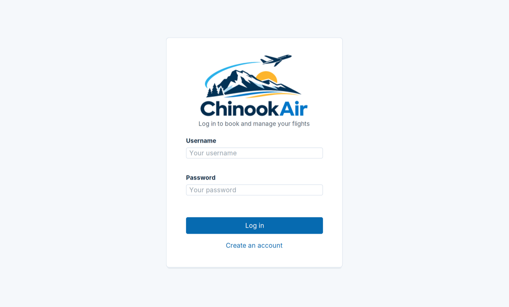
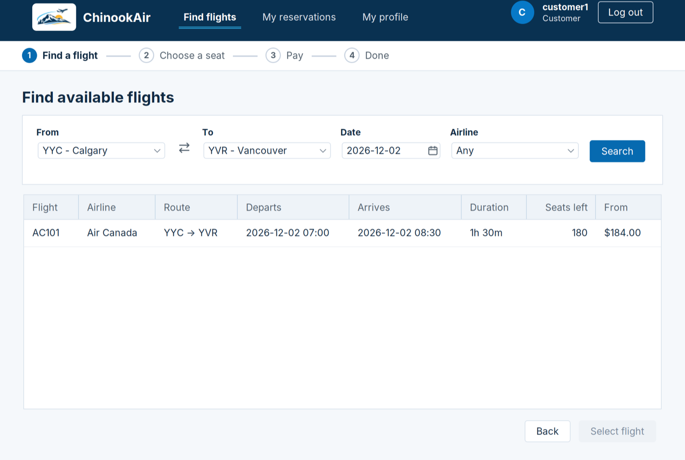
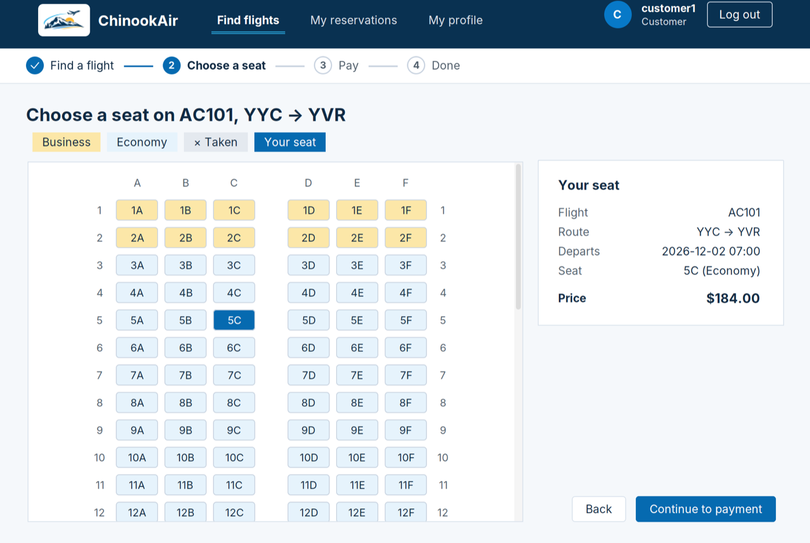
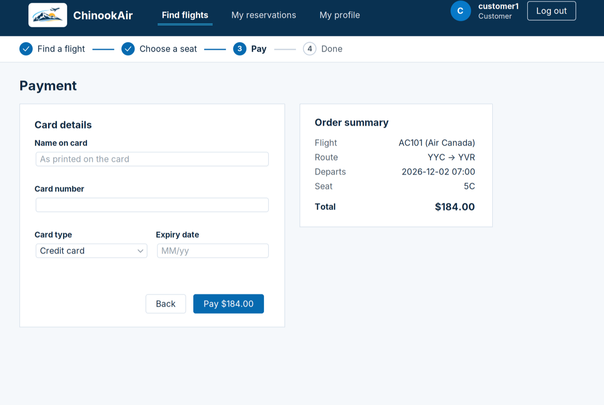
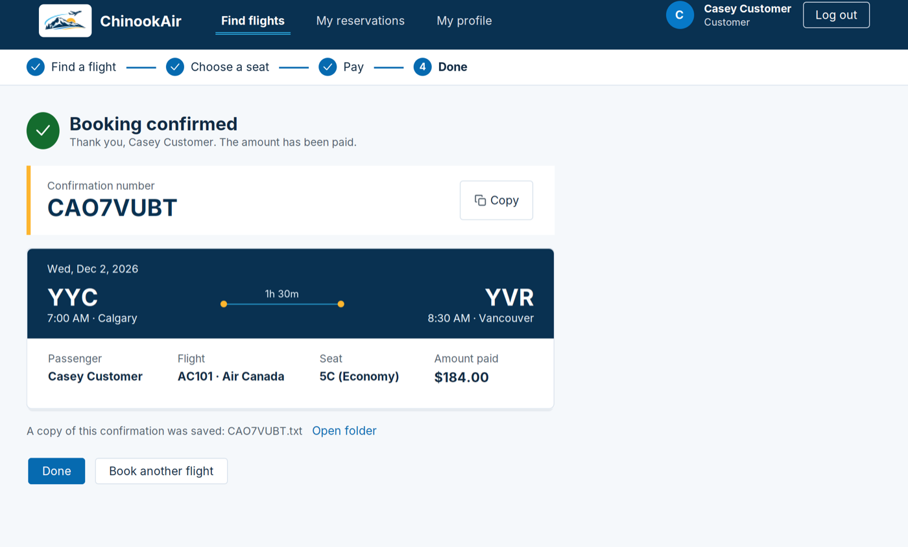
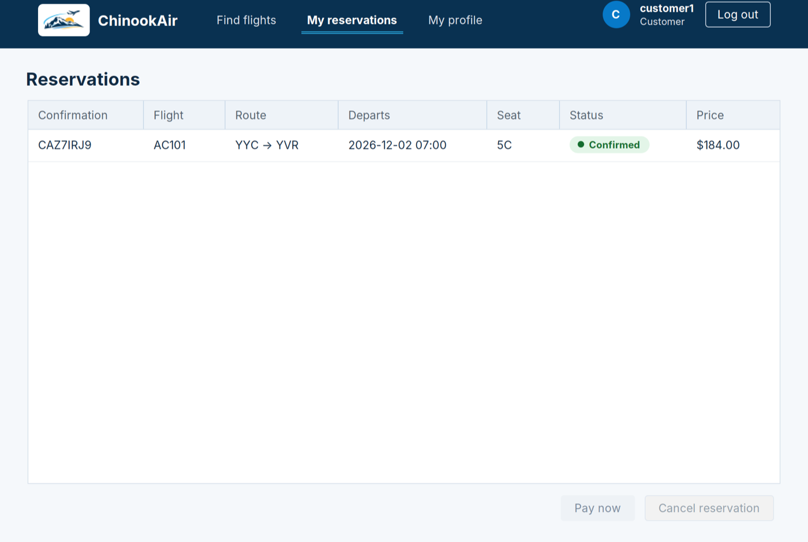
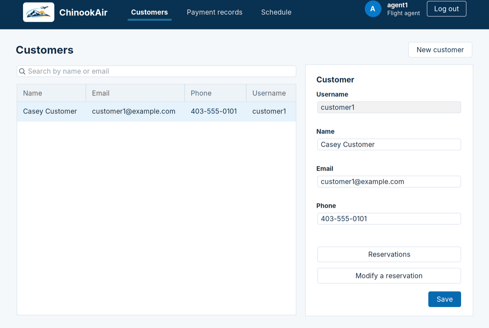
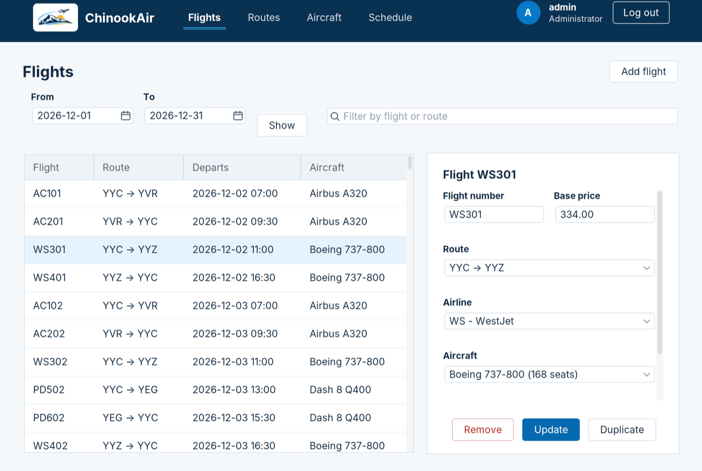

# ChinookAir

Flight reservation system for the ENSF 614 term project (Group 15).

A standalone desktop app in Java (Swing + SQLite). You log in as a customer,
flight agent or admin and get the screens for that role.

## Build and run

Needs JDK 17+ and Maven.

```
mvn clean package
java -jar target/ChinookAir.jar
```

## Demo accounts

The first start creates a database in `~/.chinookair/chinookair.db` with demo
flights for the next 60 days, 12 promotions and three accounts. Move the file
with `-Dchinookair.db=/path/to/file.db`.

| Role | Username | Password |
|---|---|---|
| Customer | `customer1` | `customer123` |
| Flight agent | `agent1` | `agent123` |
| Administrator | `admin` | `admin123` |

Passwords are stored as PBKDF2 hashes, never as text.

## Screens

The colours come from the ChinookAir logo, the font is Inter, and each role gets its own tabs in the
top bar.

| | |
|---|---|
|  |  |
| Log in | Find flights (customer) |
|  |  |
| Choose a seat | Payment |
|  |  |
| Confirmation | My reservations |
|  |  |
| Customers (flight agent) | Flights (administrator) |

Keyboard: Cmd+1, Cmd+2 and so on (Ctrl on Windows and Linux) open the tabs of the top bar, Enter presses the
main button of a screen, and Esc closes a dialog.

## Project layout

Three layers, one package each:

```
src/main/java/ca/ucalgary/chinookair/
├── ChinookAir.java          entry point
├── presentation/            Swing screens (boundary)
├── business/
│   ├── control/             controllers, one per use case
│   └── entity/              domain classes
└── data/                    SQLite connection + DAOs
docs/                        design document and UML diagrams
```

Screens call controllers, controllers use entities and DAOs.
Nothing in `presentation` should touch the database directly.

## Tests and style checks

```
mvn verify
```

runs Checkstyle (120 columns, no unused imports, braces on every block) and the unit tests.
The coverage report is written to `target/site/jacoco/index.html`.
